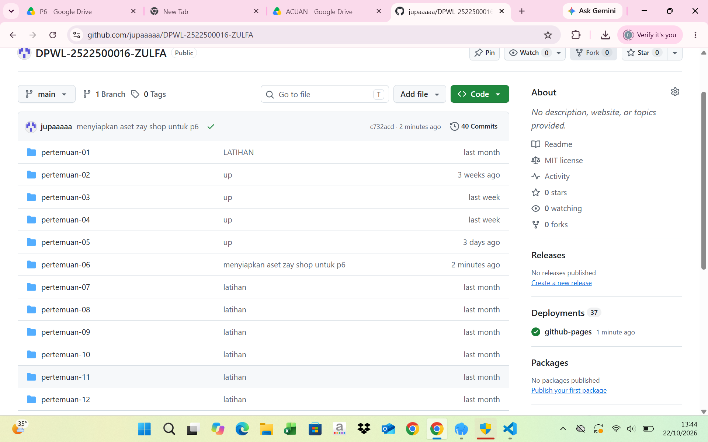
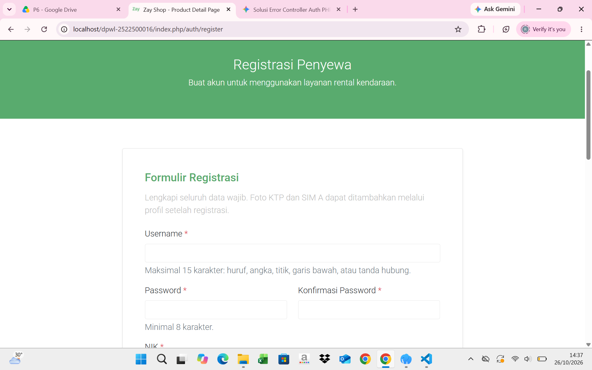
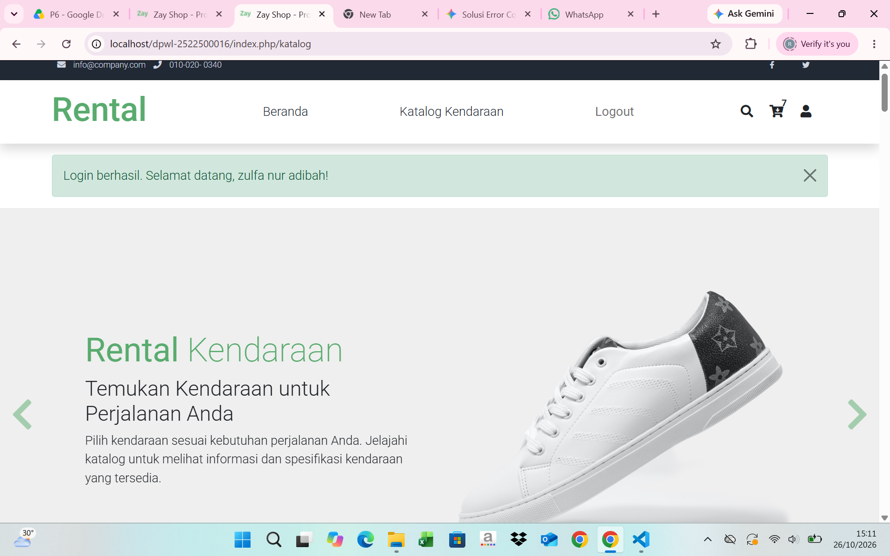
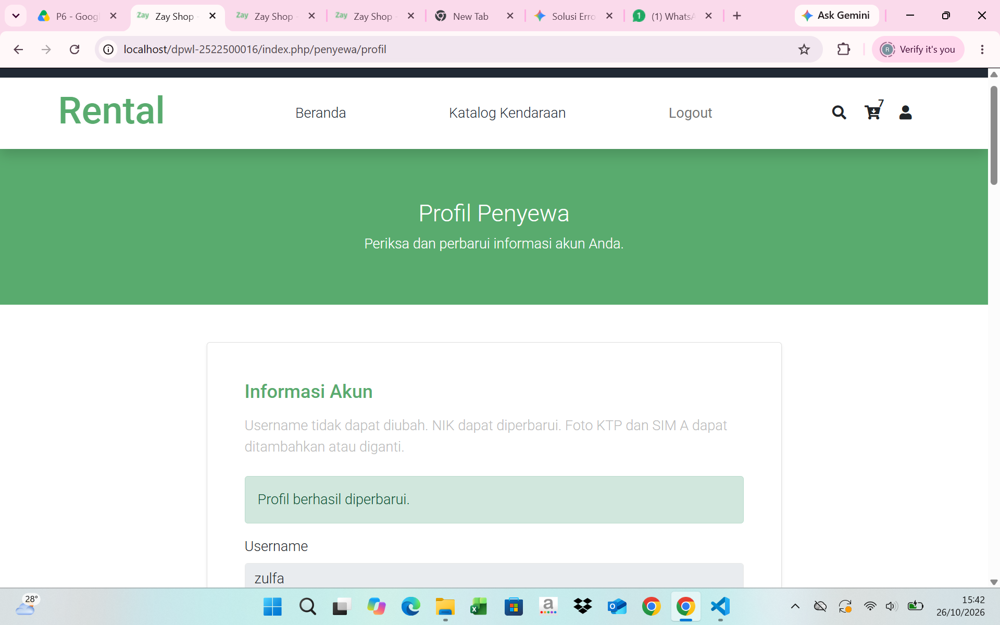

# pertemuan-06
1. Menyiapkan aset Zay Shop untuk P6

2. Menyiapkan router,model, controller dan view register penyewa untuk p6

3. Menyiapkan route, model, controller, dan view login dan logout penyewa untuk P6

4. Menyiapkan route, model, controller, dan view profil penyewa untuk P6

