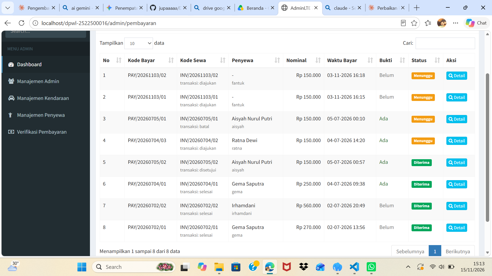
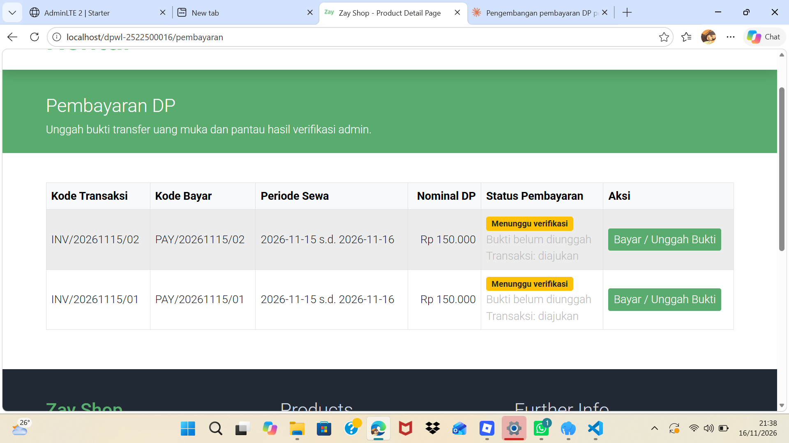
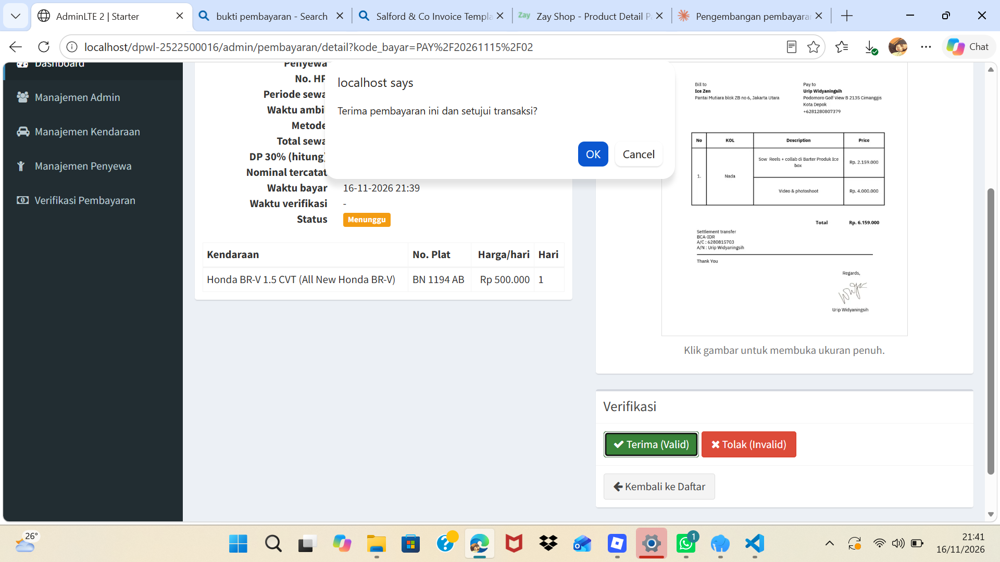
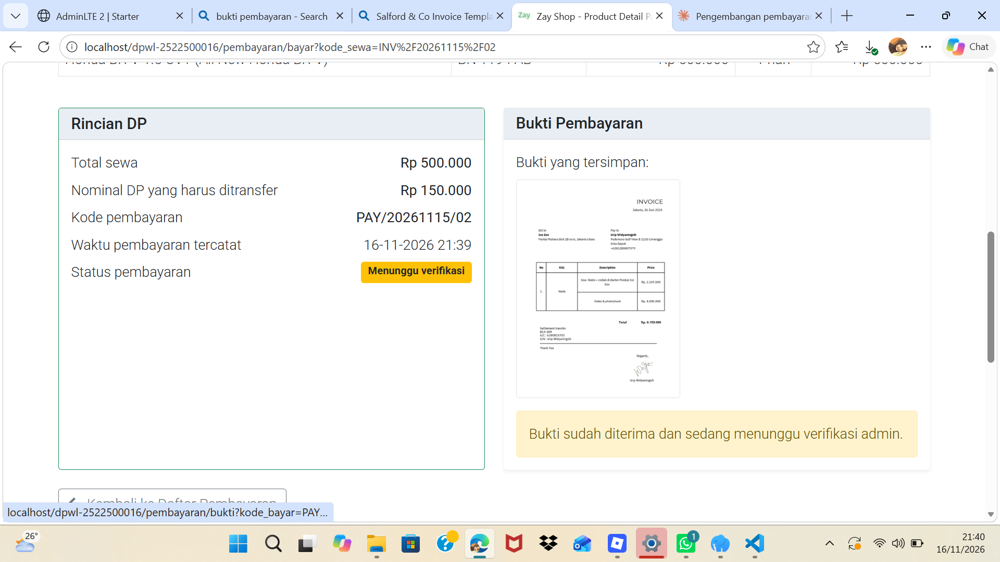
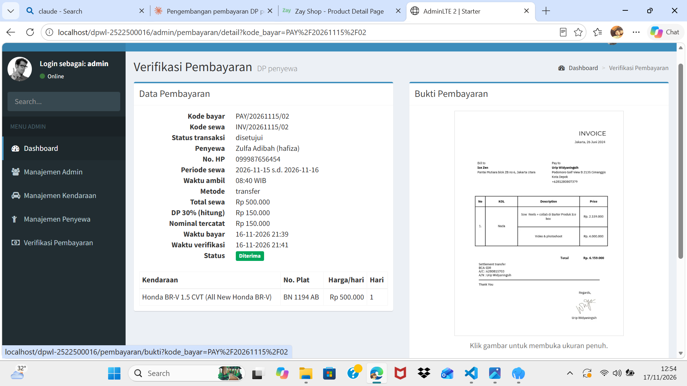
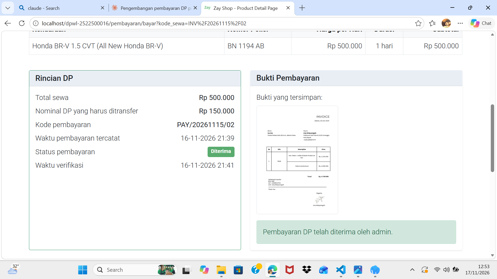
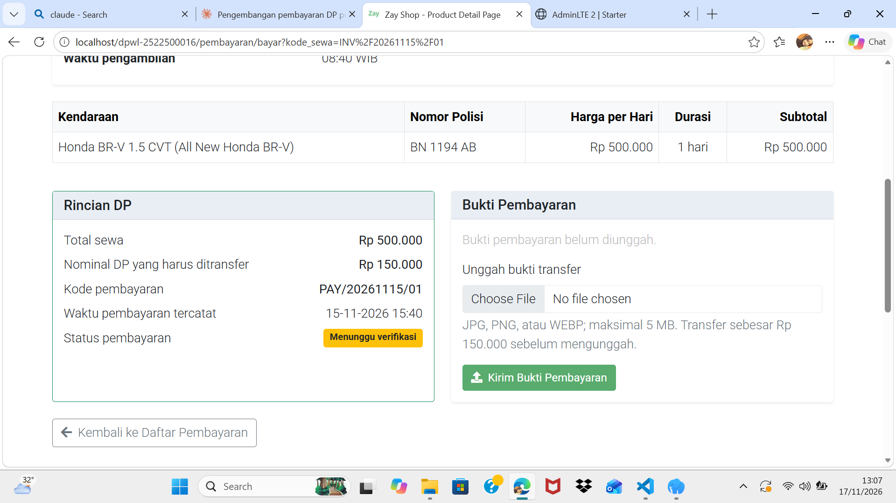
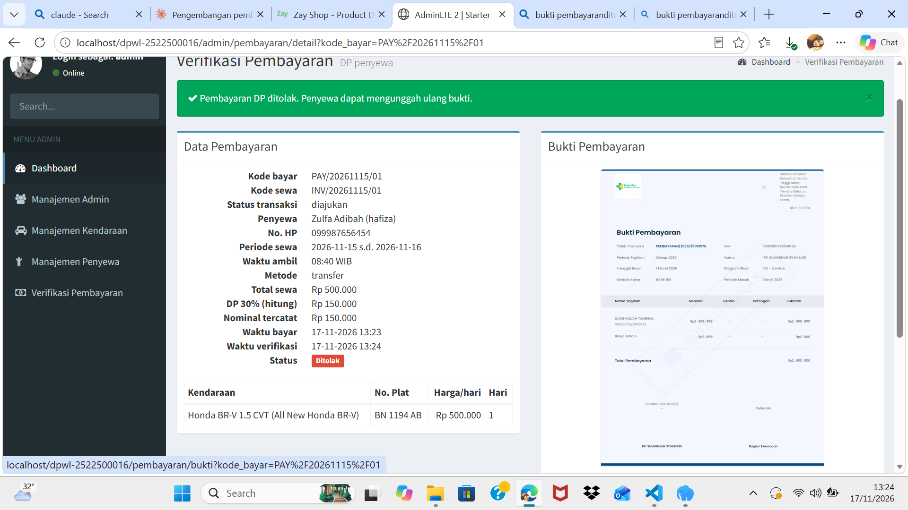
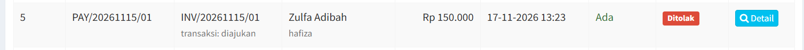
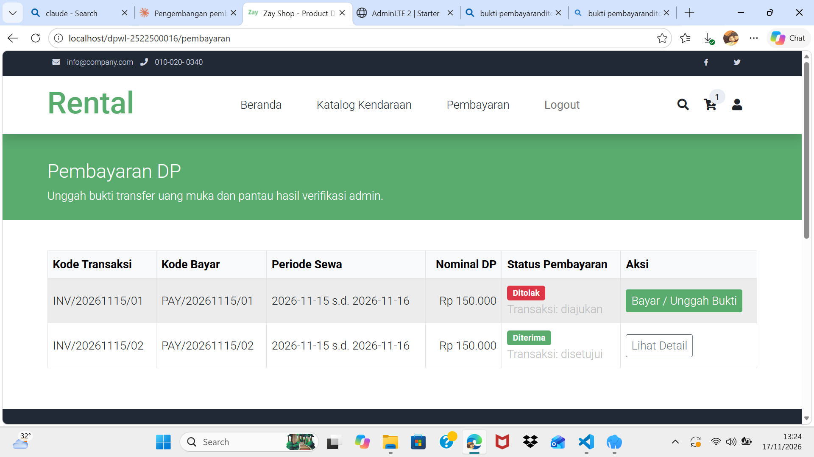

# pertemuan-09
1. Jelaskan fitur yang ditambahkan dan file yang mengalami perubahan.
saya membuat halaman pembayaran penyewa agar penyewa dapat mengunggah bukti transfer DP 30% dari transaksi yang sudah di-checkout.
saya membuat proses unggah bukti yang memperbarui record DP yang sudah dibuat saat checkout P7, bukan membuat record DP baru.
saya membuat menu verifikasi pembayaran untuk admin berisi daftar, detail, dan tombol terima atau tolak
saya menambahkan token CSRF, pembatasan akses, dan penyimpanan bukti yang tertutup agar bukti pembayaran tidak bisa dibuka sembarang orang.
perubahan dan file yang saya buat.
saya membuat menu daftar pembayaran penyewa dengan membuat application\views\pembayaran\index.php
saya membuat halaman pembayaran dan form unggah bukti dengan membuat application\views\pembayaran\form.php
saya membuat proses pembayaran penyewa dengan membuat application\controllers\Pembayaran_controller.php
saya membuat query pembayaran dan verifikasi dengan membuat application\models\Pembayaran_model.php
saya membuat halaman verifikasi admin dengan membuat application\controllers\Mpembayaran_controller.php dan application\views\admin\mpembayaran_view.php
saya membuat token CSRF dengan membuat application\helpers\csrf_helper.php
menambahkann 6 baris route baru pertemuan-09\application\config\routes.php
saya menutup akses langsung ke bukti pembayaran dengan membuat uploads\bayar\.htaccess
2. Sertakan hasil pengujian skenario pembayaran dan verifikasi.

3. Sertakan tangkapan layar halaman pembayaran penyewa.

4. Sertakan tangkapan layar daftar dan detail verifikasi admin

5. Sertakan tangkapan layar hasil pembayaran diterima dan ditolak

